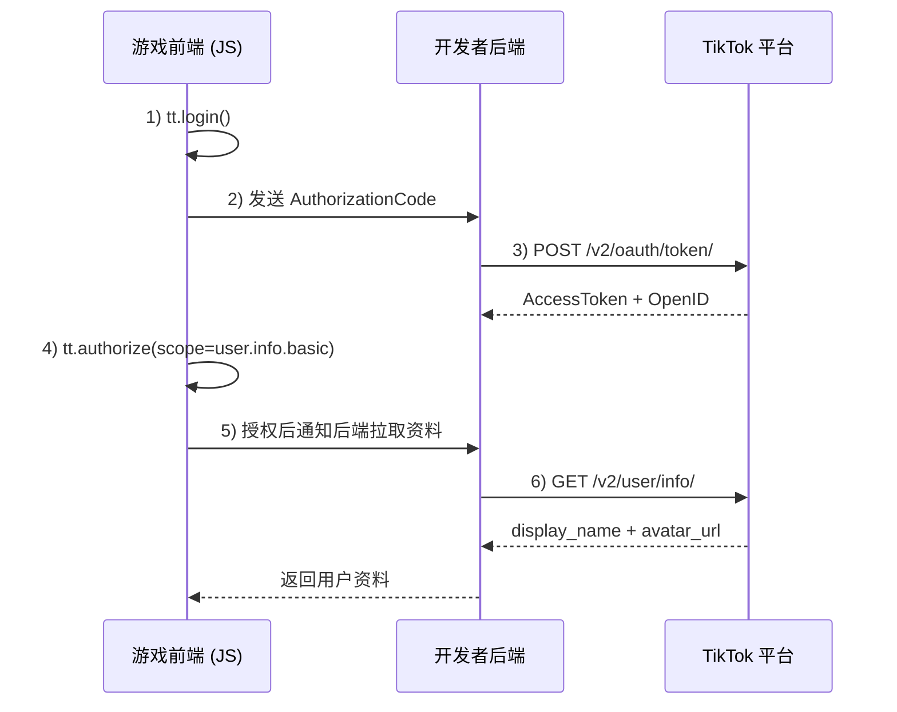

> 归档来源：`cocosgame2/experience/03-平台接入与发布/TT-授权与用户资料接入.md`。历史项目记录；具体实现、参数与成功范围须重新核验。

# TT 平台接入要点（授权与用户资料）

## 使用说明（示例与通用边界）
- 文中 API 命名（`tt.*`、`TTMinis.game.*`）为常见封装示例。
- 实际项目以当前 SDK 版本与平台文档为准。
- 重点是“身份获取、授权时机、后端拉资料、拒绝兜底”这条流程思路。

## 一、核心差异
TikTok 小游戏授权体系与抖音/微信小游戏差异较大，核心点如下：

1. 无客户端资料接口
- 不提供类似 `tt.getUserInfo` / `wx.getUserProfile` 的前端直接取昵称头像能力。

2. 用户资料必须走后端
- 昵称、头像等资料必须由开发者后端通过 TikTok Open API 获取。

3. 静默登录 vs 显式授权
- `tt.login`：静默获取身份标识（用户无感）。
- `tt.authorize`：显式授权（弹窗），用于用户资料权限（如 `user.info.basic`）。

## 二、接入流程（推荐）

1. 分阶段授权
- 不要在游戏启动即弹授权。
- 先静默登录进入游戏。
- 在排行榜/个人主页等需要资料场景，再引导用户点击触发 `tt.authorize`。

2. 拒绝授权要降级
- 用户拒绝后，游戏仍需正常运行。
- 使用默认头像 + 默认昵称（如 `TikTok Player`）。



## 三、详细步骤

### 1) 静默登录获取身份（OpenID）
- 前端调用：`TTMinis.game.login`（或等价 `tt.login`）。
- 后端用 `AuthorizationCode` 换取：`access_token` + `open_id`。
- 用途：用户唯一身份、存档、资产绑定。

### 2) 需要资料时触发显式授权
- 前端调用：`TTMinis.game.authorize`（或等价 `tt.authorize`）。
- scope：`user.info.basic`。

```js
TTMinis.game.authorize({
  scope: "user.info.basic",
  success: () => {
    console.log("用户已同意授权基础信息");
    // 通知后端去调用 Open API 获取资料
  },
  fail: (err) => {
    console.warn("用户拒绝授权", err);
  }
});
```

### 3) 后端获取用户资料（唯一合法路径）
- Open API：`GET https://open.tiktokapis.com/v2/user/info/`
- 请求头：`Authorization: Bearer {access_token}`
- 常用返回字段：`display_name`（昵称）、`avatar_url`（头像）

## 四、最佳实践

1. 用 `open_id` 做数据库主键
- 昵称/头像可变，`open_id` 是资产绑定的稳定键。

2. 按需调用登录与授权
- `tt.login`：拿身份标识。
- `tt.authorize`：拿资料权限。
- 注意：仅登录获得的 token 不等于可直接拉用户资料。

3. 后端持久化 + 前端缓存
- 后端：存储昵称头像并记录更新时间。
- 前端：`tt.setStorage` 缓存，减少首屏留白。
- 建议 3~7 天异步刷新，不要每次登录都拉资料。

4. 配置服务器域名白名单
- 在 TikTok 开发者后台配置后端域名到安全白名单（Trust domains）。
- 否则真机/正式环境请求可能失败。

5. 拒绝授权时要兜底
- 返回默认头像/昵称即可。
- 不要强退、不要反复骚扰弹窗。

## 五、常见问题

Q1: 为什么找不到 `tt.getUserInfo`？
- A: TikTok 不允许前端直接拿用户资料，必须后端换 token 并调用 Open API。

Q2: 授权弹窗会一直出现吗？
- A: 通常不会。用户同意或拒绝后会缓存结果；重置需在 TikTok 设置中撤销授权。

Q3: 不授权资料可以支付吗？
- A: 可以。支付通常只依赖身份标识（`open_id`），不强依赖昵称头像授权。

## 六、接入验收清单
- `tt.login` 成功且后端可拿到稳定 `open_id`。
- 用户拒绝授权时主流程不阻断。
- 授权后能成功返回并展示昵称头像。
- 白名单环境下网络请求稳定。
- 资产全部绑定 `open_id`，不绑定昵称/头像。

## 备注
- 不同 SDK 包装可能使用 `tt.*` 或 `TTMinis.game.*` 命名，按当前项目 SDK 实际 API 为准。
